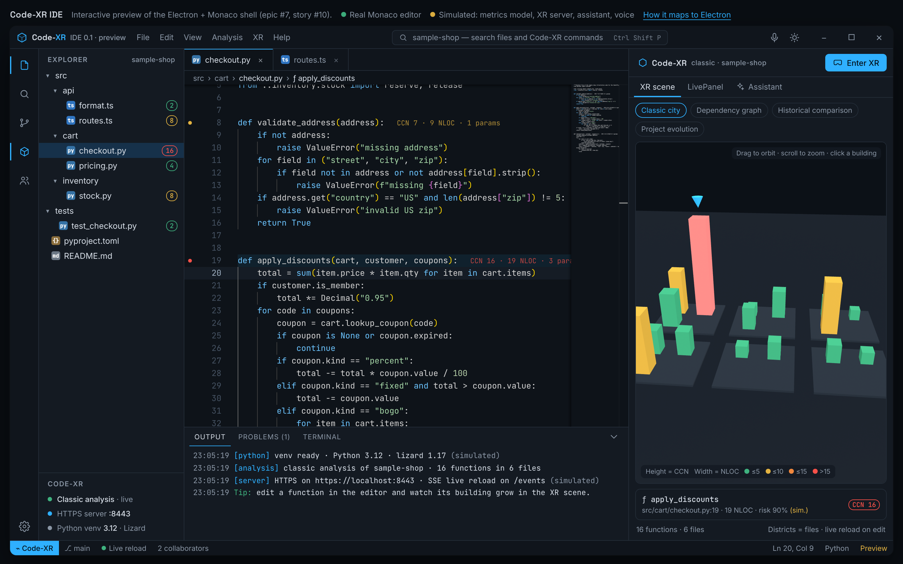
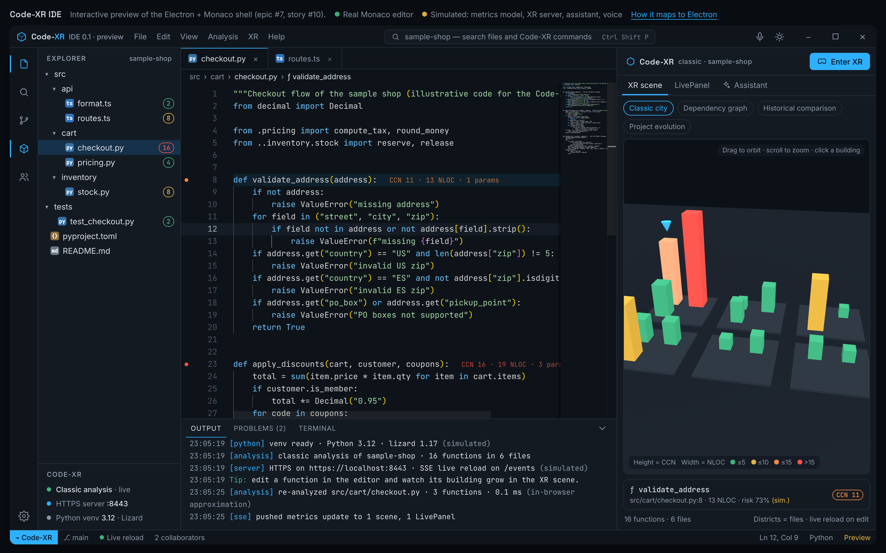
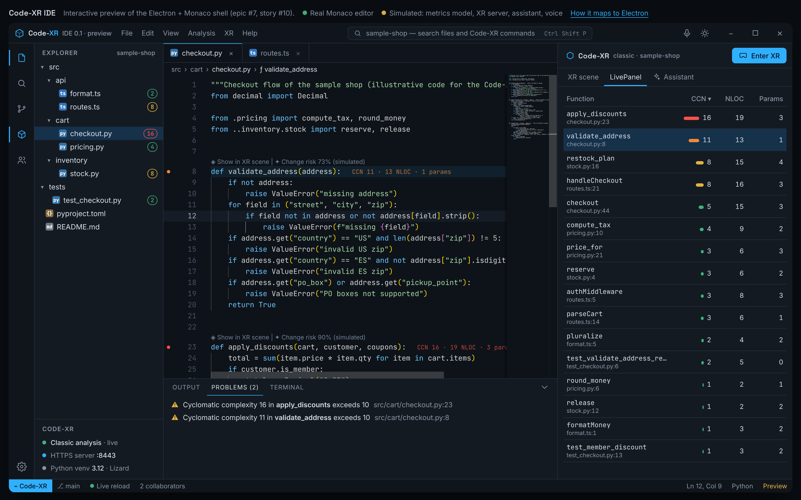
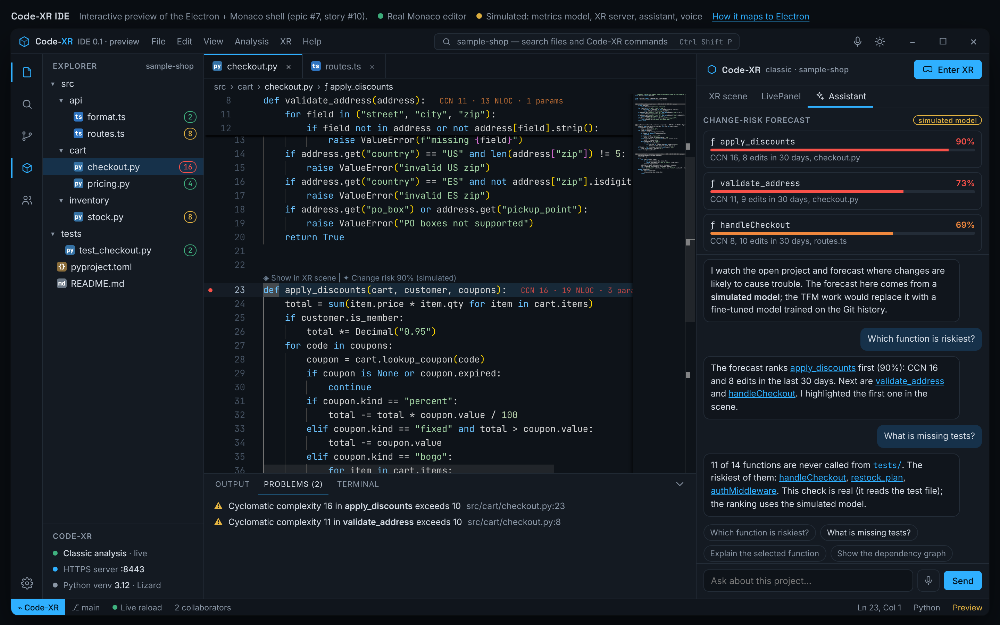
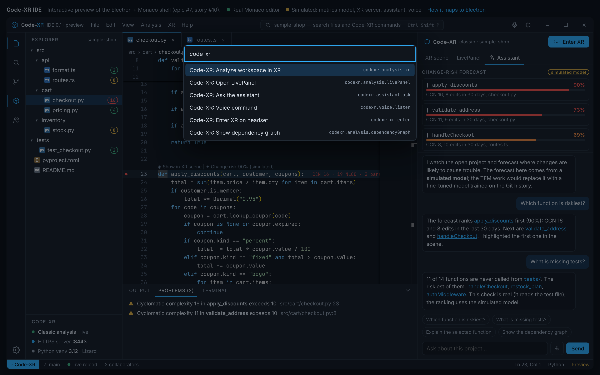
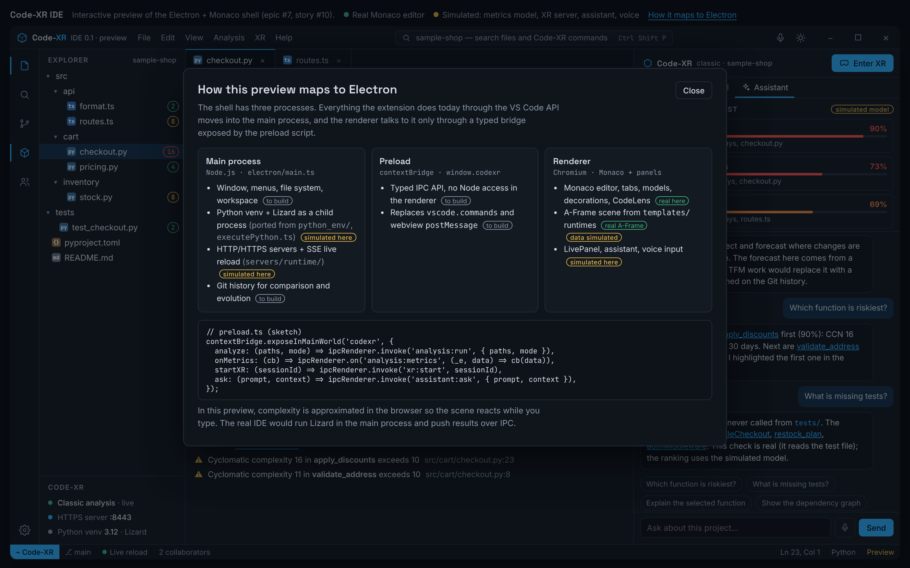
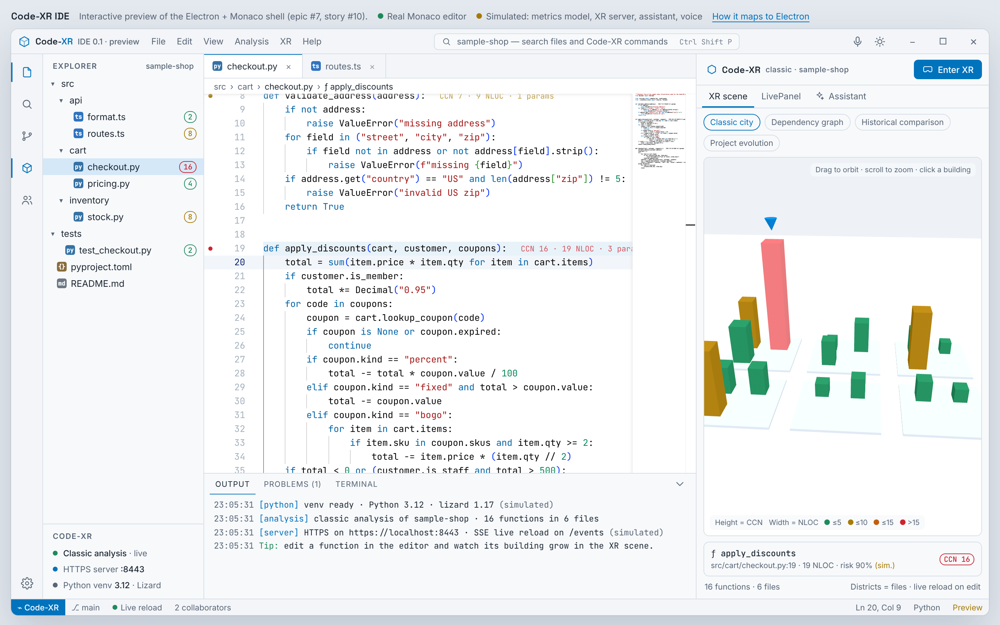
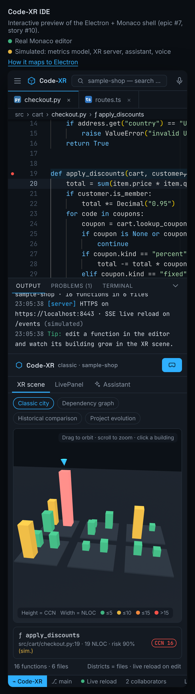

# Code-XR IDE preview (Electron + Monaco)

Screenshots of the interactive preview built for epic #7, user story #10, after
Electron + Monaco was chosen as the platform for the standalone Code-XR IDE
(see ADR 0001). They are kept here so the thesis can reference the prototype
once the live page is gone.

Live preview (private to the author): https://claude.ai/artifact/MNkzbjWJ2tRHV8hgMU4sPG

## What is real and what is simulated

| Part | Status |
|---|---|
| Monaco editor: tabs, models, syntax highlighting, CodeLens, hovers, decorations | Real |
| A-Frame "classic city" scene (height = CCN, width = NLOC, colour = CCN band) | Real A-Frame; data from an in-browser approximation |
| Complexity per function | Approximated in the browser while typing; the IDE would run Lizard in the main process |
| HTTPS server, SSE live reload, Python venv, terminal | Simulated |
| Change-risk forecast and assistant | Simulated (scripted answers, deterministic pseudo-data); the "missing tests" check really reads the test file |
| Voice input | Simulated (canned transcript) |
| Dependency graph, historical comparison, project evolution | Not in the preview |

The workspace shown (`sample-shop`) is illustrative code written for the preview.

## Screenshots

Captured at 1440x900 CSS px (2x), except the narrow layout (390 px wide, full page).

1. `01-workbench-xr-scene-dark.png`: the full workbench. Explorer with the highest CCN per file, Monaco with inline metrics, the XR scene with the selected function marked.
2. `02-live-edit-reanalysis-dark.png`: after adding branches to `validate_address`, its CCN goes from 7 to 11, its building grows, and the output log shows the re-analysis and the SSE push.
3. `03-livepanel-and-problems-dark.png`: the LivePanel table and the Problems list (functions above CCN 10).
4. `04-assistant-risk-forecast-dark.png`: the assistant with the simulated change-risk forecast and two answered questions.
5. `05-command-palette-dark.png`: the command palette filtered to Code-XR commands.
6. `06-electron-process-mapping-dark.png`: how the preview maps to the main, preload and renderer processes, with a sketch of the preload API.
7. `07-workbench-xr-scene-light.png`: the workbench in the light theme.
8. `08-narrow-layout-dark.png`: the narrow (phone-width) layout.

