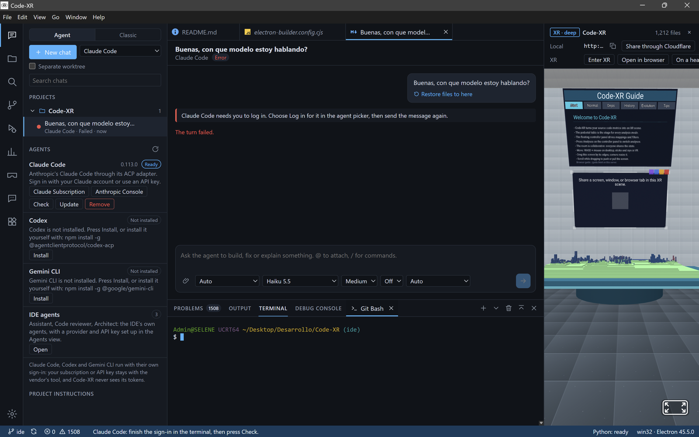
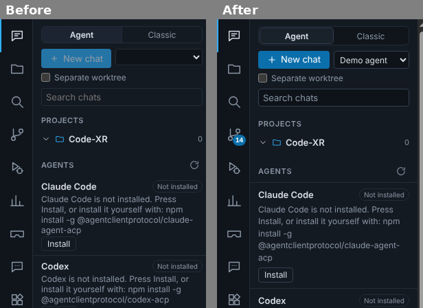
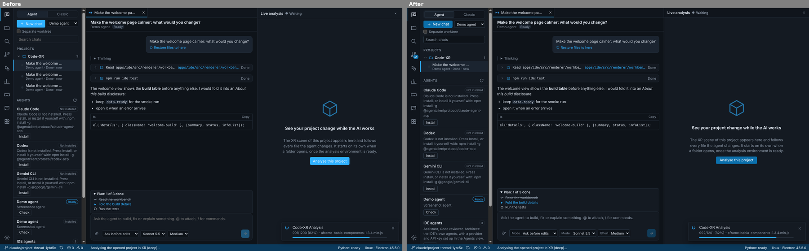
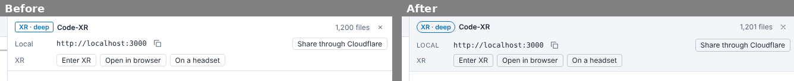
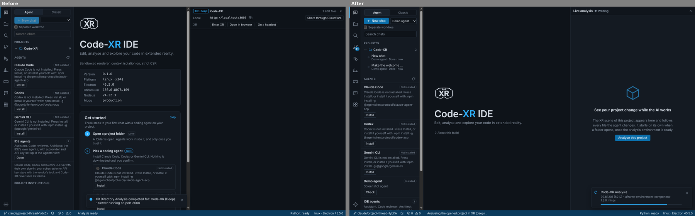
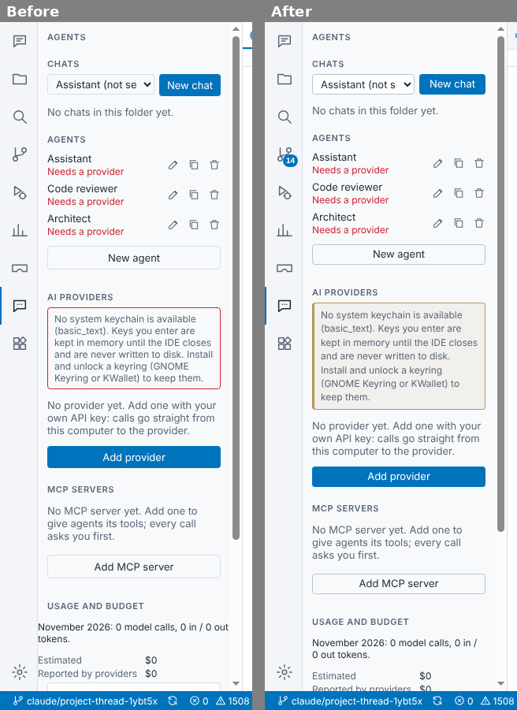
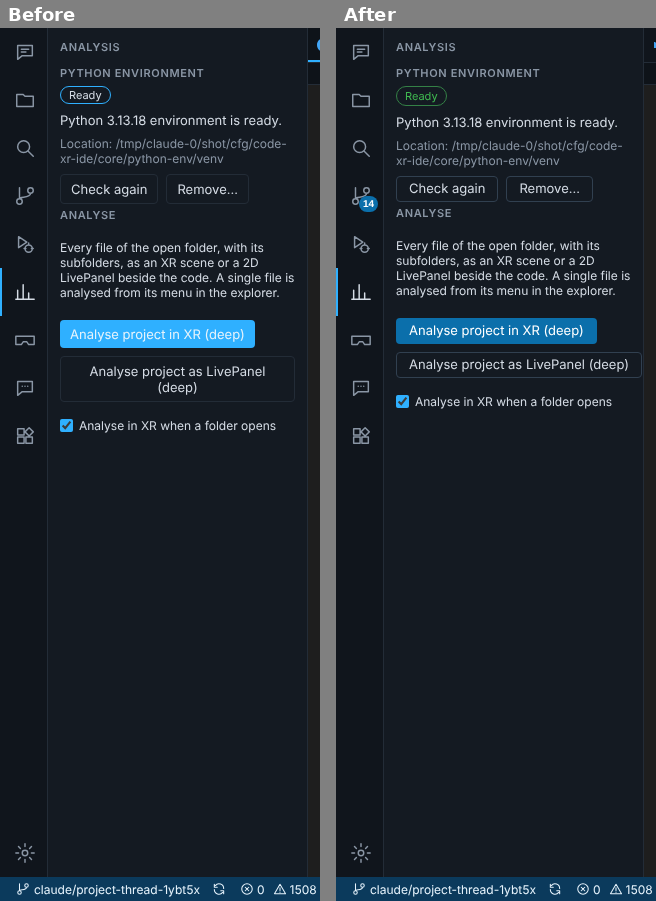
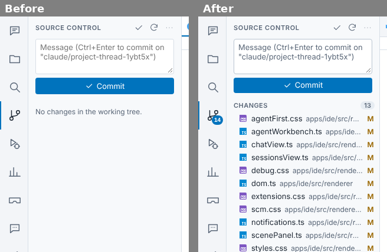
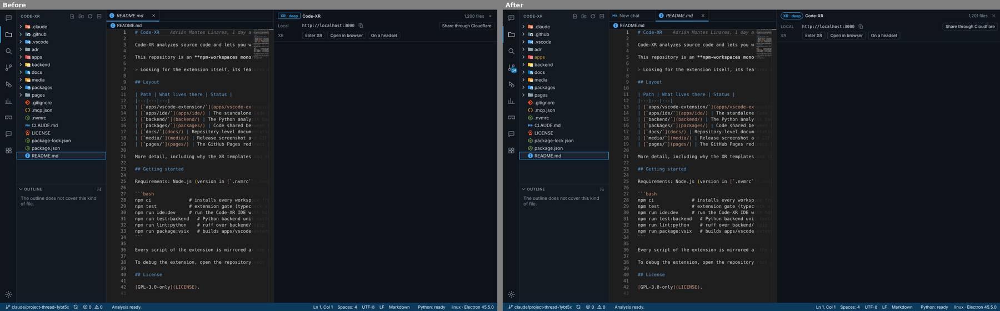

# Code-XR IDE: visual and consistency audit

Epic #300 (stories V1-V7, #301-#307). Branch `ide`, `apps/ide/src/renderer`.

The IDE was built story by story (scaffold, explorer, terminal, Git, debugger, extensions, AI agents, the agent-first layout), and each story styled its own corner. The result works, but it does not look like one product. This audit lists what drifted, compares it with VS Code, Cursor and Zed, and records what was changed. Screenshots are taken from the built app (Electron 45, Linux, 1440x873, `nativeTheme` switched for each theme) and, for the report that started it, from Adrián's Windows machine.

## 1. What the reference IDEs have in common

| Trait | VS Code | Cursor | Zed | Code-XR before |
|---|---|---|---|---|
| Type scale | 11 / 12 / 13 px, 13 body | same as VS Code | 3 sizes | 11 sizes from 9 to 24 px |
| Control height | 26 px buttons and inputs | 26-28 px | 24-28 px | 20, 22, 24, 26, ~30 px, and native inputs |
| Radius | 2-4 px controls, 6 px cards | 4-8 px | 4-6 px | 2, 3, 4, 5, 6, 7, 8, 9, 10 px |
| Column headers | 35 px, all aligned | 35 px | aligned | tabs 35 px, dock ~33 px, scene header ~93 px |
| Filled buttons | dark blue, white text | brand fill, white text | quiet | `#2fb0ff` with near-white text (about 2.1:1) |
| Colours | theme tokens only | theme tokens | theme tokens | 30+ hex values outside the theme block |
| Errors | one notice, tinted | one notice | one notice | red bar plus a second red "The turn failed." |

## 2. Findings

Severity: **high** breaks readability or looks broken, **medium** is visibly inconsistent, **low** is polish.

### Foundations (V1, V2)

| # | Finding | Severity | Where |
|---|---|---|---|
| F1 | No type scale: 9, 10, 11, 12, 13, 14, 15, 16, 18, 22, 24 px are all in use. | medium | every stylesheet |
| F2 | Nine border radii for the same kinds of element (badges at 8, 9 and 10 px). | low | every stylesheet |
| F3 | Hard-coded colours: the "added" green `#3fb950`/`#1a7f37` in 10 rules (each with its own light override), debugger reds and yellows, the Restricted Mode text, image viewer checkerboard. | medium | git, debug, agentFirst, viewers |
| F4 | Primary buttons put `--status-fg` (`#e6f3fc`) on `--accent` (`#2fb0ff`): about 2.1:1 contrast in the dark theme. | **high** | New chat, Analyse project, Add provider, Commit |
| F5 | Five shadows written by hand, black even in the light theme. | low | menus, palette, notifications |
| F6 | Text fields and selects have no shared style: some use `--panel` (invisible on the side bar), some 22, 24 or 26 px, and the chat's selects and the agent picker fall back to Chromium's native look on Windows. | **high** | Agents view, Agent mode, panels |
| F7 | Buttons of four heights (padding-driven), primary full-width by default next to secondary auto-width ones. | medium | Analysis, Agents, notifications |
| F8 | The monospace stack is written 25 times, in two variants; one rule uses an undefined `--mono`. | low | everywhere |

### Agent mode (V3, V4)

| # | Finding | Severity |
|---|---|---|
| A1 | With no agent installed the agent picker beside New chat is an empty box: nothing says why New chat is disabled. | medium |
| A2 | The Agent/Classic switch looks like two table cells, not a segmented control. | low |
| A3 | Agent cards: uneven padding, no top separator, buttons with mixed heights (Claude Subscription / Check / Update / Remove on Windows). | medium |
| A4 | Composer options are bare values ("Auto", "Haiku 5.5", "Medium", "Off", "Auto"): nothing says which is the mode, the model or the effort. | **high** |
| A5 | A failed turn shows a red-edged notice and then a second red line, "The turn failed.". | medium |
| A6 | The send button and the done-step marker use the low-contrast accent fill (F4). | medium |

### Columns, dock and scene header (V5)

| # | Finding | Severity |
|---|---|---|
| C1 | The scene header is three loose rows (~93 px) whose first row does not line up with the editor tabs; the dock head is ~33 px. | medium |
| C2 | In a narrow dock the XR buttons are cut ("On a hea" in the Windows report) instead of wrapping. | **high** |
| C3 | Close buttons are a text "×" in the scene header, the dock and notifications, an SVG X in tabs: different weight and size. | low |

### Welcome view (V6)

| # | Finding | Severity |
|---|---|---|
| W1 | The first thing under the logo is a developer table (Version, Platform, Electron, Chromium, Node.js, Mode) and "Sandboxed renderer, context isolation on, strict CSP.". | medium |

### Side-bar views (V7)

| # | Finding | Severity |
|---|---|---|
| S1 | Agents view: the "Usage and budget" summary touches the side bar's left edge (no gutter). | medium |
| S2 | Agents view: the keychain information note is a red error box. | medium |
| S3 | Analysis view: "Ready" badge is neutral; the LivePanel button wraps onto two lines. | low |
| S4 | Status-bar items are not vertically centred in some states. | low |

## 3. What changed

### V1 Design tokens (#301)

`styles.css` now opens with the token set, with light values where they differ:

| Group | Tokens |
|---|---|
| Surfaces | `--chrome`, `--panel`, `--editor`, `--raised`, `--line`, `--line-strong`, `--hover`, `--active` |
| Text and roles | `--fg`, `--muted`, `--accent`, `--ok`, `--crit`, `--warn`, `--on-warn`, `--symbol`, `--button-bg`, `--button-hover`, `--on-accent`, `--status`, `--status-fg`, `--status-debug`, `--breakpoint`, `--debug-frame` |
| Type | `--font-ui`, `--font-mono`, `--fs-2xs` 10, `--fs-xs` 11, `--fs-sm` 12, `--fs-md` 13 (body), `--fs-lg` 14, `--fs-xl` 16, `--fs-2xl` 22 |
| Shape | `--radius-sm` 3, `--radius` 4, `--radius-md` 6, `--radius-lg` 8, `--radius-pill` |
| Depth | `--shadow-sm`, `--shadow-md`, `--shadow-lg` (lighter and tinted in the light theme) |
| Layout | `--control-h` 26, `--control-h-sm` 22, `--header-h` 35 |

Every stylesheet of the renderer was rewritten onto them (about 270 values). `test/designTokens.test.ts` fails on a hex colour, a px font size (icon glyphs excepted), a px radius, an rgba shadow or a hand-written monospace stack outside the token blocks, so the drift cannot come back silently.

Filled buttons use `--button-bg` (`#0b6fab` dark, `#0073bd` light) with white text: 5.4:1 and 5.0:1.

### V2 Controls (#302)

- `.primary-button` and `.secondary-button` share one rule: 26 px, 4 px radius, 12 px padding, icon slot, disabled at 50%. Danger is a secondary button with a red border that tints on hover.
- One rule styles every input and select (13 classes): editor surface, `--line-strong` border, muted placeholder, accent border plus a 1 px outline on focus. Native look is gone on every platform.
- Checkboxes and radios take `--button-bg`.

### V3 Agent sessions column (#303)

- The mode switch is a segmented control: a recessed track, the active segment raised with a 1 px outline.
- With no agent installed the picker reads "No agent yet" (disabled option) next to the disabled New chat button.
- Agent cards: 8 px 12 px padding, separators above and below, 22 px small buttons.

### V4 Chat and composer (#304)

- Each composer option is a chip with its name: **Mode** Ask before edits, **Model** Sonnet 5.5, **Effort** Medium. The chip hides with its select when an agent has no modes.
- Warning and error notices are cards tinted with their colour and a 3 px edge; the turn-failed footer is now muted and small, so the error reads once.
- The send button uses `--button-bg`; the composer gains a soft shadow on focus.

### V5 Column headers (#305)

- `--header-h` drives the editor tab strip, the panel header, the dock head and the scene header's first row, so the top edge is one line across the three columns.
- The scene header sits on `--chrome` like the tab strip; its rows wrap, its labels are small caps, its buttons are 22 px and the share button stays at the right.
- A shared `closeIcon()` (`renderer/dom.ts`) draws the same SVG X for the scene, the dock and notifications.

### V6 Welcome view (#306)

The build table and the sandbox line are folded into an **About this build** disclosure, closed by default and opened by a start-up error. `data-ready` is unchanged, so the smoke run's welcome check still holds.

### V7 Side-bar views (#307)

- The usage summary keeps the 12 px gutter; the keychain note is an amber notice.
- Python "Ready" is a green pill; LivePanel fits on one line with the new button padding.
- Status-bar items are centred.

## 4. Not changed, and next candidates

- The agent cards still print the vendor's install sentence with the `npm install -g ...` command; a code chip with a copy button would be clearer. That text comes from `agentSetupModel.ts`, which the sign-in and chat-import work (#299) is changing, so it waits for that to land.
- Tool rows in the chat repeat the path in the title and in the link.
- The XR scene itself (A-Frame) and Monaco's theme are outside this epic; the scene could not be rendered in the cloud container (no WebGL), so its screenshots show an empty slot.
- A high-contrast theme would now be a token block, not a rewrite.

## 5. How to check by hand

1. `npm run ide:dev`, open a folder, switch Help > Toggle theme (or the OS theme) between light and dark.
2. Agent mode: the picker without agents, a chat with an agent (option chips, a failed turn), the dock and scene header at a narrow width (drag the sash until the XR buttons wrap).
3. Classic mode: editor tabs, scene header and panel tabs on one line; Analysis, Agents, Source Control, Settings views.
4. Welcome view: About this build is closed and opens.
